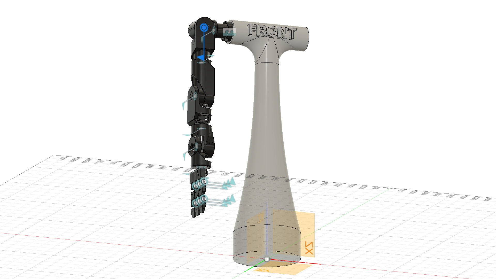

# JAXV2_Assembly — Robot Description



## Overview

| Property | Value |
|----------|-------|
| Total mass | 23.917 kg |
| Links | 16 |
| Joints | 15 (14 movable) |
| Assemblies | 1 |
| Root link | `base_link` |

## Table of Contents

- [Kinematic Tree](#kinematic-tree)
- [Link Properties](#link-properties)
- [Joint Properties](#joint-properties)
- [Assembly Breakdown](#assembly-breakdown)
- [Quick Start (ROS 2)](#quick-start-ros-2)
- [Files](#files)

## Kinematic Tree

```
base_link
  └─ base_link_to_shoulder_pitch [fixed]
    Shoulder_Pitch
      └─ shoulder_pitch_to_shoulder_roll [revolute]
        Shoulder_Roll [BAKE]
          └─ shoulder_roll_to_shoulder_yaw [revolute]
            Shoulder_Yaw [BAKE]
              └─ shoulder_yaw_to_upper_arm [revolute]
                Upper_Arm [BAKE]
                  └─ upper_arm_to_under_arm [revolute]
                    Under_Arm [BAKE]
                      └─ under_arm_to_wrist_pitch [revolute]
                        Wrist_Pitch [BAKE]
                          └─ wrist_pitch_to_wrist_yaw [revolute]
                            Wrist_yaw [BAKE]
                              └─ wrist_yaw_to_hand_base [revolute]
                                MG996R [BAKE]
                                  └─ hand_base_to_rotation_base [revolute]
                                    RotationBody [BAKE]
                                      └─ rotation_base_to_finger_3_1 [revolute]
                                        Finger_3_1 [BAKE]
                                          └─ finger_3_1_to_finger_3_2 [revolute]
                                            Finger_3_2 [BAKE]
                                  └─ hand_base_to_finger_1_1 [revolute]
                                    Finger_1_1 [BAKE]
                                      └─ finger_1_1_to_finger_1_2 [revolute]
                                        Finger_1_2 [BAKE]
                                  └─ hand_base_to_finger_2_1 [revolute]
                                    Finger_2_1 [BAKE]
                                      └─ finger_1_2_to_finger_2_2 [revolute]
                                        Finger_2_2 [BAKE]
```

## Link Properties

| Link | Mass (kg) | Material | Collision | Bodies |
|------|-----------|----------|-----------|--------|
| `Finger_1_1` | 0.0714 | Acetal_Resin_White | box | 3 |
| `Finger_1_2` | 0.0113 | Acetal_Resin_White | box | 2 |
| `Finger_2_1` | 0.0714 | Acetal_Resin_White | box | 3 |
| `Finger_2_2` | 0.0113 | Acetal_Resin_White | box | 2 |
| `Finger_3_1` | 0.0714 | Acetal_Resin_White | box | 3 |
| `Finger_3_2` | 0.0113 | Acetal_Resin_White | box | 2 |
| `MG996R` | 0.4199 | Generic | box | 6 |
| `RotationBody` | 0.0745 | Acetal_Resin_White | box | 3 |
| `Shoulder_Pitch` | 0.9973 | Acetal_Resin_White | sphere | 2 |
| `Shoulder_Roll` | 1.0877 | Acetal_Resin_White | sphere | 2 |
| `Shoulder_Yaw` | 1.1454 | Acetal_Resin_White | box | 2 |
| `Under_Arm` | 0.3461 | Acetal_Resin_White | box | 2 |
| `Upper_Arm` | 0.4106 | Acetal_Resin_White | box | 2 |
| `Wrist_Pitch` | 0.1892 | Acetal_Resin_White | box | 3 |
| `Wrist_yaw` | 0.1463 | Acetal_Resin_White | box | 3 |
| `base_link` | 18.8518 | Acetal_Resin_White | box | 1 |

## Joint Properties

| Joint | Type | Parent → Child | Axis | Limits |
|-------|------|---------------|------|--------|
| `base_link_to_shoulder_pitch` | fixed | `base_link` → `Shoulder_Pitch` | (0,0,1) | — |
| `finger_1_1_to_finger_1_2` | revolute | `Finger_1_1` → `Finger_1_2` | (0,0,1) | [0.0°, 120.0°] |
| `finger_1_2_to_finger_2_2` | revolute | `Finger_2_1` → `Finger_2_2` | (0,0,1) | [0.0°, 120.0°] |
| `finger_3_1_to_finger_3_2` | revolute | `Finger_3_1` → `Finger_3_2` | (0,0,1) | [0.0°, 120.0°] |
| `hand_base_to_finger_1_1` | revolute | `MG996R` → `Finger_1_1` | (0,0,1) | [-90.0°, 90.0°] |
| `hand_base_to_finger_2_1` | revolute | `MG996R` → `Finger_2_1` | (0,0,1) | [-90.0°, 90.0°] |
| `hand_base_to_rotation_base` | revolute | `MG996R` → `RotationBody` | (0,0,1) | [-180.0°, 0.0°] |
| `rotation_base_to_finger_3_1` | revolute | `RotationBody` → `Finger_3_1` | (0,0,1) | [-90.0°, 90.0°] |
| `shoulder_pitch_to_shoulder_roll` | revolute | `Shoulder_Pitch` → `Shoulder_Roll` | (0,0,1) | [-45.0°, 45.0°] |
| `shoulder_roll_to_shoulder_yaw` | revolute | `Shoulder_Roll` → `Shoulder_Yaw` | (0,0,1) | [0.0°, 45.0°] |
| `shoulder_yaw_to_upper_arm` | revolute | `Shoulder_Yaw` → `Upper_Arm` | (0,0,1) | [-90.0°, 240.0°] |
| `under_arm_to_wrist_pitch` | revolute | `Under_Arm` → `Wrist_Pitch` | (0,0,1) | [-90.0°, 90.0°] |
| `upper_arm_to_under_arm` | revolute | `Upper_Arm` → `Under_Arm` | (0,0,1) | [-105.0°, 105.0°] |
| `wrist_pitch_to_wrist_yaw` | revolute | `Wrist_Pitch` → `Wrist_yaw` | (0,0,1) | [-90.0°, 90.0°] |
| `wrist_yaw_to_hand_base` | revolute | `Wrist_yaw` → `MG996R` | (0,0,1) | [-120.0°, 120.0°] |

## Assembly Breakdown

### JAXV2_Assembly

- **Links**: Shoulder_Pitch, Shoulder_Roll, Shoulder_Yaw, Upper_Arm, Under_Arm, Wrist_yaw, Wrist_Pitch, MG996R, RotationBody, Finger_1_1, Finger_1_2, Finger_2_1, Finger_2_2, Finger_3_1, Finger_3_2, base_link
- **Total mass**: 23.917 kg

## Quick Start (ROS 2)

```bash
# 1. Copy package to your ROS 2 workspace
cp -r JAXV2_Assembly_description ~/ros2_ws/src/

# 2. Build
cd ~/ros2_ws
colcon build --packages-select JAXV2_Assembly_description
source install/setup.bash

# 3. Visualize in RViz2
ros2 launch JAXV2_Assembly_description display.launch.py

# 4. Validate URDF structure
check_urdf install/JAXV2_Assembly_description/share/JAXV2_Assembly_description/urdf/JAXV2_Assembly.urdf

# 5. Print kinematic tree
urdf_to_graphviz install/JAXV2_Assembly_description/share/JAXV2_Assembly_description/urdf/JAXV2_Assembly.urdf
```

**Joint control**: The launch file includes `joint_state_publisher_gui` —
use the sliders to move revolute/prismatic joints in RViz2.

**Topic inspection**:
```bash
# See published joint states
ros2 topic echo /joint_states

# See robot description parameter
ros2 param get /robot_state_publisher robot_description
```

## Files

| Path | Description |
|------|-------------|
| `urdf/JAXV2_Assembly.urdf.xacro` | Top-level xacro (entry point) |
| `urdf/JAXV2_Assembly.urdf` | Flat URDF (for validation) |
| `urdf/assemblies/` | Per-assembly xacro macros |
| `meshes/` | Visual (OBJ) and collision (STL) meshes |
| `launch/display.launch.py` | Launch robot_state_publisher, RViz, and generated controllers |
| `config/joint_state.yaml` | Joint state publisher config |
| `config/ros2_controllers.yaml` | Generated ros2_control controller manager config |
| `robot_data.yaml` | Supplementary data (beyond URDF) |
| `docs/transforms.md` | Transformation matrices (KaTeX) |

## Customizing

Assemblies tagged `!dummy_` are designed to be swapped out. To replace one:

1. Create your replacement as a xacro macro with the same interface
2. Place it in `urdf/assemblies/`
3. Update the `<xacro:include>` in `urdf/JAXV2_Assembly.urdf.xacro`
4. Update meshes in `meshes/<your_assembly>/`

The xacro prefix system (`${prefix}`) ensures link names stay unique
when multiple instances of the same assembly are used.

---
*Generated by Fusion URDF/XACRO Exporter v3.1.1*